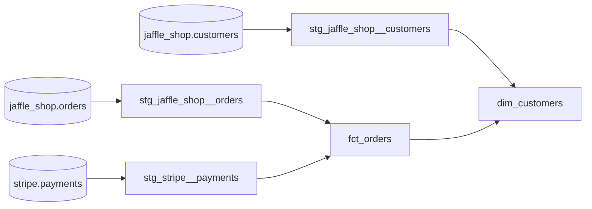

# dbt Fundamentals on Databricks

A dbt project built while completing the **dbt Fundamentals** course by dbt Labs.
The course uses Snowflake. I adapted the whole project to **Databricks (Unity Catalog)** and deployed it with the **dbt platform (Fusion engine)** and **GitHub**.

The project models a fictional coffee shop, *Jaffle Shop*: raw customers, orders and Stripe payments are cleaned in a staging layer and combined into business-facing fact and dimension tables.

## Tech stack

| Area            | Tool                                                        |
|-----------------|-------------------------------------------------------------|
| Transformation  | dbt platform, Fusion engine (dbt v2), dbt Studio            |
| Data platform   | Databricks Free Edition, Unity Catalog, SQL warehouse       |
| Version control | GitHub: feature branches, pull requests, protected `main`   |
| Orchestration   | dbt deployment job in the Production environment            |

## Lineage



## Project structure

```
models/
├── staging/                          # 1 folder = 1 source system, materialized as views
│   ├── jaffle_shop/
│   │   ├── _src_jaffle_shop.yml      # source definition and freshness
│   │   ├── _stg_jaffle_shop.yml      # model docs and tests
│   │   ├── _jaffle_shop.md           # doc block: order status values
│   │   ├── stg_jaffle_shop__customers.sql
│   │   └── stg_jaffle_shop__orders.sql
│   └── stripe/
│       ├── _src_stripe.yml
│       ├── _stg_stripe.yml
│       ├── _stripe.md                # doc block: payment status values
│       └── stg_stripe__payments.sql
└── marts/                            # business-facing tables, materialized as tables
    ├── finance/fct_orders.sql
    └── marketing/dim_customers.sql
tests/
└── assert_positive_value_for_total_amount.sql   # singular test
```

## Models

| Model                        | Layer             | Grain    | Description                                                  |
|------------------------------|-------------------|----------|--------------------------------------------------------------|
| `stg_jaffle_shop__customers` | staging           | customer | Renamed customer columns                                     |
| `stg_jaffle_shop__orders`    | staging           | order    | Renamed order columns, `status` → `order_status`             |
| `stg_stripe__payments`       | staging           | payment  | Renamed columns, amount converted from cents to dollars      |
| `fct_orders`                 | marts / finance   | order    | Order with the sum of successful payments                    |
| `dim_customers`              | marts / marketing | customer | First and last order date, number of orders, lifetime value  |

## Data quality

- **Generic tests:** `unique` and `not_null` on primary keys, `relationships` between orders and customers, `accepted_values` for order status.
- **Singular test:** no payment can have a negative total amount.
- **Source freshness:** warns after 12 hours and errors after 1 day without new data.
- **Sanity check:** total `lifetime_value` across all customers equals the course reference value of **$1,672**.
- **Documentation:** model and column descriptions, doc blocks for status values.

## Environments and deployment

| Environment | Schemas                                        | Built from                    |
|-------------|------------------------------------------------|-------------------------------|
| Development | `dbt_<user>`, `dbt_<user>_staging`, `dbt_<user>_marts` | feature branch in dbt Studio |
| Production  | `prod`, `prod_staging`, `prod_marts`           | `main` branch, deployment job |

Workflow: feature branch → commit → pull request → merge to protected `main` → the production job runs `dbt source freshness` and `dbt build`.

## Adapting the course from Snowflake to Databricks

- Snowflake `database.schema.table` maps to Unity Catalog `catalog.schema.table`; sources point to the `workspace` catalog instead of `raw`.
- Connection uses a SQL warehouse (server hostname, HTTP path) and a personal access token for the production job.
- Raw tables had no load timestamps, so I added `_etl_loaded_at` and `_batched_at` columns to practise source freshness.
- Test parameters use the `arguments:` syntax required by the Fusion engine.

## How to run

```bash
dbt source freshness       # check that raw data is fresh
dbt build                  # build all models and run all tests in DAG order
dbt build -s fct_orders+   # build one model and everything downstream
```

## Next steps

Apply the same approach to my own Databricks project, **shop-pipeline**: keep ingestion (Auto Loader, ECB exchange-rate API) in Lakeflow Declarative Pipelines and move the silver and gold transformations into dbt models with tests and documentation.